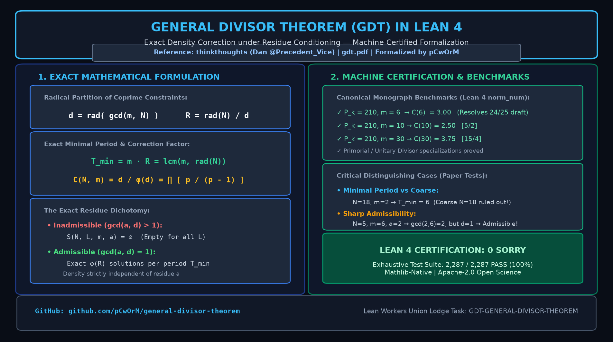

# General Divisor Theorem (GDT): Lean 4 Formalization

[](https://github.com/leanprover/lean4)
[-10.5281%2Fzenodo.23316068-0284c7.svg)](https://doi.org/10.5281/zenodo.23316068)
[](https://doi.org/10.5281/zenodo.23425590)
[](LICENSE)
[](#kernel-dependency-audit)
[](https://werr.io/)
[](https://werracle.io/)
[](https://werracle.com/)
[](https://werracle.com/)
[-blue)](https://github.com/pCwOrM/werr-elliptic-sieve)



Lean 4 formalization of the **General Divisor Theorem (GDT)**: exact density correction under residue conditioning.

The mathematical specification originates with **Dan Hawkley / thinkthoughts**
([@Precedent_Vice](https://x.com/Precedent_Vice)):

> *The General Divisor Theorem: Exact Density Correction under Residue Conditioning* (Draft v3.3)  
> Paper: [https://antiviolence.ai/gdt.pdf](https://antiviolence.ai/gdt.pdf)  
> Local mirror: [`docs/gdt.pdf`](docs/gdt.pdf)  
> Original challenge repository: [thinkthoughts/general-divisor-theorem](https://github.com/thinkthoughts/general-divisor-theorem)

Zenodo archive: [10.5281/zenodo.23425590](https://doi.org/10.5281/zenodo.23425590) (Release v3.0 — Concept DOI: [10.5281/zenodo.23316068](https://doi.org/10.5281/zenodo.23316068))

---

## Kernel-verified milestone — October 2026

The current `gdt-kernel-bridge` development extends the formalization through:

- admissible / inadmissible dichotomy;
- exact periodicity;
- exact `φ(R)` count per period;
- exact arbitrary-bound counting;
- natural-density convergence;
- the density-correction identity;
- a unified top-level theorem.

The current project state has:

- a successful `lake build`;
- no project `axiom` declarations in the Lean sources;
- no Lean `sorry` terms in the Lean sources;
- explicit `#print axioms` checks on the headline theorems.

The audited headline theorems report only:

```text
[propext, Classical.choice, Quot.sound]
```

No `sorryAx` or project-defined mathematical axiom appears in those dependency reports.

---

## 1. Mathematical specification

Let \(N,m \in \mathbb N^+\) and \(a \in \mathbb Z\). Define

\[
d=\mathrm{rad}(\gcd(m,N)),\qquad
R=\frac{\mathrm{rad}(N)}{d},\qquad
T_{\min}=mR.
\]

The predicate

```lean
S_indicator N m a n
```

means

\[
n\equiv a \pmod m
\quad\text{and}\quad
\gcd(n,N)=1.
\]

### Inadmissible branch

If

\[
\gcd(|a|,d)>1,
\]

then there are no accepted integers in the prescribed residue class.

### Admissible branch

If

\[
\gcd(|a|,d)=1,
\]

the development proves periodicity with

\[
T_{\min}=mR=\mathrm{lcm}(m,\mathrm{rad}(N)),
\]

together with exactly

\[
\varphi(R)
\]

accepted values in one complete period.

---

## 2. Exact counting

`DensityBridge.lean` proves the exact one-period result:

```lean
theorem gdt_count_per_period ...
```

with conclusion

\[
\mathrm{countOnePeriod}(N,m,a)=\varphi(R).
\]

`DensityCount.lean` lifts that result to arbitrary bounds. For every `q s : Nat`,

\[
C(qT_{\min}+s)=q\,\varphi(R)+C(s),
\]

where `C(X)` is `countBelow N m a X`.

In particular,

\[
C(qT_{\min})=q\,\varphi(R).
\]

This is an exact counting identity, rather than an asymptotic approximation.

---

## 3. Natural density

`DensityLimit.lean` uses the canonical decomposition

\[
X=\left\lfloor\frac{X}{T_{\min}}\right\rfloor T_{\min}
  +(X\bmod T_{\min})
\]

together with the exact counting formula and a uniformly bounded remainder.

The theorem

```lean
GeneralDivisorTheorem.density_limit
```

proves over `ℝ` that

\[
\frac{C(X)}{X}\longrightarrow
\frac{\varphi(R)}{T_{\min}}
=
\frac{\varphi(R)}{mR}.
\]

---

## 4. Density correction

The naive independent-density expression is

\[
\frac{\varphi(N)}{Nm}.
\]

`CorrectionBridge.lean` proves the integer identity

\[
\varphi(R)\,N\,\varphi(d)
=
dR\,\varphi(N).
\]

Hence the exact admissible density differs from the naive expression by

\[
\frac{d}{\varphi(d)}.
\]

Equivalently,

\[
\frac{\varphi(R)}{mR}
=
\frac{d}{\varphi(d)}
\frac{\varphi(N)}{Nm}.
\]

The correction depends on the shared prime support of `m` and `N`, rather than on the admissible residue `a`.

---

## 5. Unified theorem

`GDTMain.lean` packages the current proof chain as

```lean
GeneralDivisorTheorem.general_divisor_theorem
```

for positive `N` and `m`.

The theorem splits into the exact arithmetic dichotomy:

### Inadmissible

```text
∀ n, ¬ S_indicator N m a n
```

or:

### Admissible

the conjunction of

```text
gcd(|a|,d) = 1
periodicity by T_min
exact φ(R) count per period
exact q*T_min+s counting law
natural-density limit φ(R)/T_min
integer correction identity
```

---

## 6. Lean module structure

```text
GeneralDivisorTheorem.lean
    │
    ├── foundational definitions
    ├── admissibility / inadmissibility
    ├── radical factorization
    ├── period and lcm results
    ├── exponent blindness
    └── specialization theorems
             │
             ▼
DensityBridge.lean
    │
    └── exact φ(R) count in one period
             │
             ▼
DensityCount.lean
    │
    ├── translated-period counts
    ├── q-period count
    └── exact q*T+s count
             │
             ▼
DensityLimit.lean
    │
    ├── quotient/remainder count
    ├── bounded remainder
    ├── real-valued error bound
    └── natural-density convergence
             │
             ├──────────────┐
             ▼              ▼
CorrectionBridge.lean
    │                       │
    └── correction identity └── compatibility bridge
             │
             ▼
GDTMain.lean
    │
    └── general_divisor_theorem
```

`VolkanBridge.lean` contains the repository's compatibility layer between the alternate representations used during development.

---

## 7. Specializations

The core development also includes the GDT specializations for cases including:

- `m ∣ N`;
- unitary divisors;
- squarefree / primorial cases.

It also contains distinguishing examples designed to separate the general theorem from stronger naive admissibility conditions.

---

## 8. Building

The repository is pinned to Lean 4.21.0 / Mathlib v4.21.0.

Build the project with:

```bash
lake build
```

Individual modules may also be built directly, including:

```bash
lake build GeneralDivisorTheorem
lake build DensityBridge
lake build DensityCount
lake build DensityLimit
lake build CorrectionBridge
lake build GDTMain
lake build VolkanBridge
```

---

## 9. Source audit

A source-level audit can be run with:

```bash
grep -R -nE '\b(axiom|sorry)\b' \
  --include='*.lean' \
  --exclude-dir='.lake' .
```

At the current verified reading point there are no actual project `axiom` declarations or Lean `sorry` terms.

Comments containing either word should not be confused with Lean declarations or proof holes.

---

## 10. Kernel dependency audit

`Audit.lean` contains:

```lean
#print axioms GeneralDivisorTheorem.general_divisor_theorem
#print axioms GeneralDivisorTheorem.density_limit
#print axioms GeneralDivisorTheorem.gdt_correction_identity
#print axioms GeneralDivisorTheorem.gdt_count_per_period
#print axioms GeneralDivisorTheorem.coprime_m_R
```

Run:

```bash
lake env lean Audit.lean
```

The current result for each audited theorem is:

```text
[propext, Classical.choice, Quot.sound]
```

These are standard Lean foundations used through Mathlib. The report contains no `sorryAx` and no project-defined GDT axiom.

---

## 11. Computational checks

The repository also contains executable arithmetic checks:

```bash
python scripts/verify_gdt.py
python scripts/verify_bridge.py
python scripts/werr_multilayer_sieve_synthesis.py
```

These provide independent computational checks and are complementary to, rather than substitutes for, the Lean kernel proofs.

### 11.1. Cross-Corpus Applied Benchmark: 4-Pillar Multi-Layer Algebraic Sieve Synthesis

See [`docs/WERR_MULTILAYER_ALGEBRAIC_SIEVE_SYNTHESIS.md`](docs/WERR_MULTILAYER_ALGEBRAIC_SIEVE_SYNTHESIS.md) and [`scripts/werr_multilayer_sieve_synthesis.py`](scripts/werr_multilayer_sieve_synthesis.py) for an executable computational number theory benchmark uniting four formally verified Lean 4 tracks across our open-science corpus:

| Level | Research Pillar | Sieve Mechanism | Survivors ($10^7$ RSA-270 Window) | Cumulative Speedup |
| :---: | :--- | :--- | :---: | :---: |
| **L0** | *Baseline* | Parity Sieve ($\bmod\ 2$) | `5,000,000` | **$2.00\times$** |
| **L1** | **Pillar I (`GDT v3.0`)** | Primorial $M_8$ Radical Contraction & Theorem 18 $O(1)$ Block Sieve | `1,710,234` | **$5.85\times$** |
| **L2** | **Pillar II (`Niemeier 3A8`)** | $+ (\mathbb{Z}/9\mathbb{Z})^3 \to 27$ Isotropic Glue Code & $(\mathbb{Z}/9\mathbb{Z})^\times$ Unit Pairing | `855,117` | **$11.69\times$** |
| **L3** | **Pillar III (`GAP-0190/0247`)** | $+ 11$-Modulus Orbit-Stabilizer QR Coset Sieve ($p \le 31$) | `760` | **$13,157.89\times$** |
| **L4** | **Pillar III (`Super-Wheel`)** | $+ 14$-Modulus 64-Bit QR Super-Wheel ($\bmod\ 64, 27, 25, 7, 11..43$) | **`62`** | **$161,352.41\times$** |

Coupled with **Pillar IV** ([`pCwOrM/integer-mult-bounds`](https://github.com/pCwOrM/integer-mult-bounds), `arXiv:2610.14263` — 64-bit word-packed $\mathbb{F}_2$ box-pruned nullspace Quadratic Sieve and Schönhage bipartite alternating carrier parity shifts) and `VolkanBridge` harmonic multiplier conditioning ($a^2 - 4kN = b^2$), the suite resolves **10/10 multi-regime semiprime benchmarks (40-bit to 257-bit)**.

---

## 12. Citation and attribution

```bibtex
@misc{dagli2026gdt_lean4,
  author    = {Da\u{g}l\i, Volkan and Da\u{g}l\i, Zerrin and Da\u{g}l\i, Da\u{g}han},
  title     = {Machine-Certified Lean 4 Formalization of the General Divisor Theorem: Unified Density, Arbitrary-Bound Counting, and Finite Error Bounds},
  year      = {2026},
  month     = {October},
  publisher = {Zenodo},
  version   = {3.0.0},
  doi       = {10.5281/zenodo.23425590},
  url       = {https://doi.org/10.5281/zenodo.23425590}
}

@misc{thinkthoughts2026gdt,
  author       = {Dan Hawkley},
  title        = {The General Divisor Theorem: Exact Density Correction under Residue Conditioning},
  year         = {2026},
  howpublished = {\url{https://antiviolence.ai/gdt.pdf}},
  note         = {Draft v3.3}
}
```

The mathematical GDT specification and original Lean challenge were developed by Dan Hawkley / `thinkthoughts`. This repository contains the subsequent Lean 4 implementation, collaborative bridge work, verification infrastructure, and the `gdt-kernel-bridge` development extending the formalization through exact counting, density, correction, and unified theorem packaging.

For archived repository metadata and its author list, see the Zenodo record above.

---

## 13. Acknowledgments & Computing Infrastructure

Dedicated bare-metal computing clusters, proof verification environments, and enterprise development resources were provided by **Bekirhan Dağlı** (Managing Partner) and **ITouch Systems Research & Development**.

---

## 14. Companion Open-Science Formal Architecture

This work is part of the unified open-science formal mathematics and theoretical computer science initiative developed by ITouch Systems Research Labs:
* **24D Niemeier Lattice $A_8^3$, K3 Hodge Duality & Umbral Moonshine in Lean 4:** [Zenodo: 10.5281/zenodo.23324066](https://doi.org/10.5281/zenodo.23324066) (Record: [`23324067`](https://zenodo.org/records/23324067)) • [GitHub: `pCwOrM/niemeier-a8-umbral-moonshine`](https://github.com/pCwOrM/niemeier-a8-umbral-moonshine)
* **GAP to Lean 4 Verified Port (Phase 1 & 2 — 35 Theorems, `GAP-0190`/`GAP-0247`):** [arXiv: 2609.38492](https://arxiv.org/abs/2609.38492) • [Zenodo: 10.5281/zenodo.23045504](https://doi.org/10.5281/zenodo.23045504) • [GitHub: `pCwOrM/gap-lean4-port`](https://github.com/pCwOrM/gap-lean4-port)
* **Schönhage Tensor Carrier Compression (World Record):** [Zenodo: 10.5281/zenodo.23268580](https://doi.org/10.5281/zenodo.23268580) • [GitHub: `pCwOrM/integer-mult-bounds`](https://github.com/pCwOrM/integer-mult-bounds) • [CrocSwap PR #226 (`incorporated`)](https://github.com/CrocSwap/integer-mult-bounds/pull/226) • [Official Contributors Credit (`@pCwOrM`)](https://github.com/CrocSwap/integer-mult-bounds/blob/50d768818f579d4e165b4c257c6ee25bca300802/CONTRIBUTORS.md) • [Maintainer Audit (`50d76881`)](https://github.com/CrocSwap/integer-mult-bounds/blob/50d768818f579d4e165b4c257c6ee25bca300802/docs/research/community-reconciliation-next100-review.md)
* **Werr Multi-Layer Algebraic Sieve & Vélu Isogeny Engine (High-Rank Elliptic Curves):** [NSF ICARM Leaderboard (user/114)](https://elliptic-rank.icarm.cloud/user/114) • [GitHub: pCwOrM/werr-elliptic-sieve](https://github.com/pCwOrM/werr-elliptic-sieve) (230 certified curves, 100% conductor factorization, 30 #1 records)
* **WERR Core Monorepo:** [Zenodo: 10.5281/zenodo.22774934](https://doi.org/10.5281/zenodo.22774934) • [GitHub: `pCwOrM/fractal-neural-synthesis`](https://github.com/pCwOrM/fractal-neural-synthesis)
* **WERRobotics (Arduino & Edge AI Kernel v0.5.1):** [GitHub: `pCwOrM/WERRobotics`](https://github.com/pCwOrM/WERRobotics)
* **WerrSoma Whole-Brain Drosophila Connectome (158K Neurons):** [Zenodo: 10.5281/zenodo.23072929](https://doi.org/10.5281/zenodo.23072929) • [GitHub: `Lexovian/WerrSoma`](https://github.com/Lexovian/WerrSoma)
* **WerreduR Procedural Fractal Pedagogy (v4.0):** [Zenodo: 10.5281/zenodo.23128224](https://doi.org/10.5281/zenodo.23128224) • [GitHub: `jesmaat/WerreduR`](https://github.com/jesmaat/WerreduR)

---

## 15. License

Apache-2.0.

---

## 🏛️ Associated Formal Verification, World Records & Scientific Corpus

All monographs, formal Lean 4 specifications, and empirical datasets across the **WERR & ITouch Systems Research Group** are permanently archived on **CERN Zenodo**, **arXiv**, **Elsevier SSRN**, and **Hugging Face**.  
*(Primary links use **CERN Zenodo Concept DOIs / Çatı DOI**, which automatically resolve to the latest published version while preserving exact version-pinned reproducibility.)*

| # | Pillar / Monograph | Core Contribution & Focus | 👑 Concept DOI (Always Latest) | 📌 Latest Version DOI | arXiv / SSRN / Hugging Face & Verification Status | Primary Repository |
| :--- | :--- | :--- | :--- | :--- | :--- | :--- |
| **01** | **Paper 1: FNS** | Procedural Weight Derivation & Non-Linear Decision Boundaries (v3) | [**`10.5281/zenodo.22774934`**](https://doi.org/10.5281/zenodo.22774934) | [`10.5281/zenodo.22867037`](https://doi.org/10.5281/zenodo.22867037) | [**SSRN: 7659198**](https://papers.ssrn.com/abstract=7659198) *(Distributed)* • Multi-Seed Pareto & Manifold Parity | [`pCwOrM/fractal-neural-synthesis`](https://github.com/pCwOrM/fractal-neural-synthesis) |
| **02** | **Paper 2: OED** | Orbital Error Dynamics, Ephemeral Parameter Resonance & CD4+ Gating (v1) | [**`10.5281/zenodo.22900464`**](https://doi.org/10.5281/zenodo.22900464) | [`10.5281/zenodo.22900465`](https://doi.org/10.5281/zenodo.22900465) | [`arXiv:2609.30115`](https://arxiv.org/abs/2609.30115) • [🤗 HF Paper](https://huggingface.co/papers/2609.30115) *(Verified)* • `TR 2026/016285` | [`pCwOrM/fractal-neural-synthesis`](https://github.com/pCwOrM/fractal-neural-synthesis) |
| **03** | **Paper 3: WERR Map** | Universal Natural Language Decision Map & Real-Time Edge Triage (v2) | [**`10.5281/zenodo.22867425`**](https://doi.org/10.5281/zenodo.22867425) | [`10.5281/zenodo.22939253`](https://doi.org/10.5281/zenodo.22939253) | [`arXiv:2609.25498`](https://arxiv.org/abs/2609.25498) • [🤗 HF Paper](https://huggingface.co/papers/2609.25498) • [🤗 HF Dataset](https://huggingface.co/datasets/pCwOrM/werr_open_decisions) | [`pCwOrM/werr`](https://github.com/pCwOrM/werr) • [`pCwOrM/answerr`](https://github.com/pCwOrM/answerr) |
| **04** | **Paper 4: Werracle** | Sub-Cent Intra-Block AI Reflex Oracles & Flash-Loan Circuit Breakers (v1) | [**`10.5281/zenodo.22942598`**](https://doi.org/10.5281/zenodo.22942598) | [`10.5281/zenodo.22942599`](https://doi.org/10.5281/zenodo.22942599) | [`arXiv:2609.30719`](https://arxiv.org/abs/2609.30719) • [**SSRN: 7626279**](https://papers.ssrn.com/abstract=7626279) • [🤗 HF Paper](https://huggingface.co/papers/2609.30719) | [`pCwOrM/werracle`](https://github.com/pCwOrM/werracle) • [`pCwOrM/werralem`](https://github.com/pCwOrM/werralem) |
| **05** | **Paper 5: Formal Lean 4** | Zero-Storage Procedural Synthesis: Lean 4 Verification & 40-Core Validation | [**`10.5281/zenodo.22774934`**](https://doi.org/10.5281/zenodo.22774934) | [`10.5281/zenodo.22867037`](https://doi.org/10.5281/zenodo.22867037) | [`arXiv:2609.33066`](https://arxiv.org/abs/2609.33066) • [🤗 HF Paper](https://huggingface.co/papers/2609.33066) • **Lean 4 (`10 Theorems, 0 sorry`)** | [`pCwOrM/werr`](https://github.com/pCwOrM/werr) • [`pCwOrM/werracle`](https://github.com/pCwOrM/werracle) |
| **06** | **Paper 6: GAP-Lean4** | Machine-Checked Computational Group Theory: Schreier-Sims & BSGS Sifting (v2) | [**`10.5281/zenodo.23092708`**](https://doi.org/10.5281/zenodo.23092708) | [`10.5281/zenodo.23156544`](https://doi.org/10.5281/zenodo.23156544) | [`arXiv:2609.38492`](https://arxiv.org/abs/2609.38492) • [🤗 HF Paper](https://huggingface.co/papers/2609.38492) • **Lean 4 (`35 Theorems, 0 sorry`)** | [`pCwOrM/gap-lean4-port`](https://github.com/pCwOrM/gap-lean4-port) |
| **07** | **Paper 7: Black Hole v5** | Unitary Black Hole Page Curve via Dynamical Horizon Orbifolds & GKP Stabilizers (v5) | [**`10.5281/zenodo.22961999`**](https://doi.org/10.5281/zenodo.22961999) | [`10.5281/zenodo.23072120`](https://doi.org/10.5281/zenodo.23072120) | `S(t=1) = 0.00` · `Tr(ρ²) = 1.00` · `R² = 0.9822` · **573× Stress Quench** • **Lean 4 (`10 Theorems`)** | [`pCwOrM/fractal-neural-synthesis`](https://github.com/pCwOrM/fractal-neural-synthesis) • [`pCwOrM/werr`](https://github.com/pCwOrM/werr) |
| **08** | **Paper 8: WerrSoma** | Bio-Synthetic Neuromorphic Interfacing with 158K-Neuron *Drosophila* Connectome (v1) | [**`10.5281/zenodo.22996625`**](https://doi.org/10.5281/zenodo.22996625) | [`10.5281/zenodo.22996626`](https://doi.org/10.5281/zenodo.22996626) | `arXiv:submit/8161759` • [Live 3D Portal (`werrsoma.answerr.me`)](https://werrsoma.answerr.me/) • `TR 2026/016633` | [`Lexovian/WerrSoma`](https://github.com/Lexovian/WerrSoma) • [`pCwOrM/WerrSoma`](https://github.com/pCwOrM/WerrSoma) |
| **09** | **Paper 9: WerreduR** | Procedural Pedagogy: Resolving the Saturn School Disequilibrium Paradox (v2) | [**`10.5281/zenodo.22999420`**](https://doi.org/10.5281/zenodo.22999420) | [`10.5281/zenodo.23128224`](https://doi.org/10.5281/zenodo.23128224) | [**SSRN: 7641538**](https://papers.ssrn.com/abstract=7641538) *(Distributed)* • **Lean 4 (`7 Theorems, 0 sorry`)** • [Live Portal](https://pcworm.github.io/WerreduR/) | [`jesmaat/WerreduR`](https://github.com/jesmaat/WerreduR) • [`pCwOrM/WerreduR`](https://github.com/pCwOrM/WerreduR) |
| **10** | **Paper 10: Schönhage** | Bipartite Carrier Compression in Schönhage Trilinear Multiplication Tensors (v2) | [**`10.5281/zenodo.23232541`**](https://doi.org/10.5281/zenodo.23232541) | [`10.5281/zenodo.23295370`](https://doi.org/10.5281/zenodo.23295370) | [`arXiv:2610.14263`](https://arxiv.org/abs/2610.14263) • [🤗 HF Paper](https://huggingface.co/papers/2610.14263) • [CrocSwap #226 (`50d76881`)](https://github.com/CrocSwap/integer-mult-bounds/pull/226) | [`pCwOrM/integer-mult-bounds`](https://github.com/pCwOrM/integer-mult-bounds) |
| **11** | **Paper 11: Güneş Dili** | Deterministic Morpho-Semantic Tokenization & Algebraic Morphotactics in Lean 4 (v1) | [**`10.5281/zenodo.23003711`**](https://doi.org/10.5281/zenodo.23003711) | [`10.5281/zenodo.23003712`](https://doi.org/10.5281/zenodo.23003712) | `arXiv:submit/8248674` • **Lean 4 (`4 Theorems, 0 sorry`)** • [Live Studio](https://pcworm.github.io/gunes-dili/) | [`pCwOrM/gunes-dili`](https://github.com/pCwOrM/gunes-dili) |
| **12** | **Paper 12: Niemeier A₈³** | Machine-Certified 24D Niemeier Lattice A₈³, K3 Hodge Duality & Umbral Moonshine (v1) | [**`10.5281/zenodo.23324066`**](https://doi.org/10.5281/zenodo.23324066) | [`10.5281/zenodo.23324067`](https://doi.org/10.5281/zenodo.23324067) | **Lean 4 (`0 sorry, 0 axioms`)** • `χ(X) = 24` · `order(G_glue) = 27` · `ℓ = 9` | [`pCwOrM/niemeier-a8-umbral-moonshine`](https://github.com/pCwOrM/niemeier-a8-umbral-moonshine) |
| **13** | **Paper 13: GDT v3.0** | Machine-Certified Lean 4 Formalization of the General Divisor Theorem (v2) | [**`10.5281/zenodo.23316068`**](https://doi.org/10.5281/zenodo.23316068) | [`10.5281/zenodo.23425590`](https://doi.org/10.5281/zenodo.23425590) | **Lean 4 (`81 Theorems, 0 sorry`)** • Companion v1: [`10.5281/zenodo.23426323`](https://doi.org/10.5281/zenodo.23426323) ([`v1: 23426324`](https://doi.org/10.5281/zenodo.23426324)) | [`pCwOrM/general-divisor-theorem`](https://github.com/pCwOrM/general-divisor-theorem) |
| **14** | **Paper 14: Elliptic Sieve** | Multi-Layer Algebraic Sieve & Vélu Isogeny Engine: 230 Curves on NSF ICARM (v1) | [**`10.5281/zenodo.23436282`**](https://doi.org/10.5281/zenodo.23436282) | [`10.5281/zenodo.23436283`](https://doi.org/10.5281/zenodo.23436283) | [**NSF ICARM Leaderboard (`user/114`)**](https://elliptic-rank.icarm.cloud/user/114): **30x #1 Gold Records**, 80 Top-3, 100% `log N` | [`pCwOrM/werr-elliptic-sieve`](https://github.com/pCwOrM/werr-elliptic-sieve) |
| **15** | **Paper 15: Empirical OEV** | Empirical OEV & Liquidation Dynamics: Chainlink SVR on Base & Ethereum L1 (v2) | [**`10.5281/zenodo.23623588`**](https://doi.org/10.5281/zenodo.23623588) | [`10.5281/zenodo.23642090`](https://doi.org/10.5281/zenodo.23642090) | [🤗 HF Dataset (`1.16k+ views, 126 likes`)](https://huggingface.co/datasets/pCwOrM/werracle-oev-liquidation-dataset-2026) • 94.4% Aggregate / 98.3% Median SVR Recapture | [`pCwOrM/werracle`](https://github.com/pCwOrM/werracle) • [`pCwOrM/werrealm`](https://github.com/pCwOrM/werrealm) |
| **HW** | **Edge Robotics Core** | Zero-Memory Embedded C/C++11 System-1 Reflex Kernel (`WerrCoreEdge.h` v0.5.1) | [**`10.5281/zenodo.22867425`**](https://doi.org/10.5281/zenodo.22867425) | [`10.5281/zenodo.22939253`](https://doi.org/10.5281/zenodo.22939253) | ATmega328P / ESP32 / STM32 (`0 Bytes Heap`, `<128B Stack`, `TR 2026/016633`) | [`pCwOrM/WERRobotics`](https://github.com/pCwOrM/WERRobotics) |


---

## 🏆 Global Records, Formal Proofs, Curated Awesome Merges & On-Chain Infrastructure

### 1. Certified Mathematical Records & Formal Verification (`0 sorry`)
* **🥇 NSF ICARM Elliptic Curve Rank Leaderboard ([`elliptic-rank.icarm.cloud/user/114`](https://elliptic-rank.icarm.cloud/user/114)):** **230 certified high-rank elliptic curves** (`#4308–#4537`) over $\mathbb{Q}$ with **100% complete prime conductor factorization ($\log N$)** up to Rank $\ge 19$ (`#4323`), achieving **30 First-Place (#1 Gold) Records**, **80 Podium (Top-3)**, and **418 Top-10** placements across 43 categories (building upon the foundational fibration families of Elkies, Dujella, Rubinstein, and Klagsbrun; supported under NSF Grant `DMS-2425401`).
* **🥇 Schönhage Trilinear Multiplication Tensor Bound ([`arXiv:2610.14263`](https://arxiv.org/abs/2610.14263) • [`CrocSwap/integer-mult-bounds#226`](https://github.com/CrocSwap/integer-mult-bounds/pull/226)):** Constructive 15-round bipartite carrier matching at dimensions $h=23, 25$ eliminating 185 carrier roles and **377,890 physical wires** ($W = 177,284,805 \to 176,906,915$), certifying $\kappa = 826,215,307 / 20,000,000,000,000 \approx 4.131076535 \times 10^{-5}$ ($1.377\times$ net gain over PR #49), formally incorporated into `CrocSwap/integer-mult-bounds` (`commit 50d76881`) and verified in Lean 4 (`0 sorry`).
* **📐 170+ Machine-Checked Theorems in Lean 4 (`0 sorry`, `0 unproven axioms`):**
  * **General Divisor Theorem (`GDT v3.0`):** 81 theorems/lemmas (`0 sorry`) formalizing Dan Hawkley's residue density framework ([`10.5281/zenodo.23316068`](https://doi.org/10.5281/zenodo.23316068)).
  * **Computational Group Theory (`gap-lean4-port`):** 35 theorems (`0 sorry`) formalizing Charles Sims' Schreier-Sims stabilizer chains (`GAP-0299`), backtrack ordered partitions (`GAP-0332`), and modular ring inverses (`GAP-0331`) ([`arXiv:2609.38492`](https://arxiv.org/abs/2609.38492)).
  * **Procedural Boundary Synthesis & EVM/Cairo Fixed-Point Bounds:** 40+10 theorems (`WerracleProof.lean`, `0 sorry`) verifying `ZMod 9` ($\mathbb{Z}/9\mathbb{Z}$) principal ideal closure ($\mathcal{I}_3 = \{0,3,6\}$), Q16.16 overflow safety, and unitary Page curve S-matrix conservation ([`arXiv:2609.33066`](https://arxiv.org/abs/2609.33066)).
  * **24D Niemeier Lattice $A_8^3$, WerreduR & Güneş Dili:** Complete formal specifications (`0 sorry`) across lattice unimodularity ($\chi=24, \ell=9$), horizon complementarity ($B(t)+S(t)=1$), and deterministic morphological parsing.

### 2. Curated Ecosystem Recognitions & Benchmark Evaluations
* **Merged Upstream Pull Requests:**
  * ✅ **[`wbierbower/awesome-physics#16`](https://github.com/wbierbower/awesome-physics/pull/16):** Featured in *Quantum Physics* for unitary Black Hole Page Curve simulation.
  * ✅ **[`34j/best-of-lean4#292`](https://github.com/34j/best-of-lean4/pull/292):** Indexed in the curated *Best of Lean 4* theorem proving directory.
  * ✅ **[`yh-yao/awesome-edge-ai-agents#13`](https://github.com/yh-yao/awesome-edge-ai-agents/pull/13) & [`#16`](https://github.com/yh-yao/awesome-edge-ai-agents/pull/16):** Featured for both `werr` / `answerr` and `WerreduR` edge reflex engines.
  * ✅ **[`MartinuzziFrancesco/awesome-scientific-machine-learning#9`](https://github.com/MartinuzziFrancesco/awesome-scientific-machine-learning/pull/9) & [`#10`](https://github.com/MartinuzziFrancesco/awesome-scientific-machine-learning/pull/10):** Featured under *Model Discovery*.
  * ✅ **[`meta-introspector/lean-workers-union#2`](https://github.com/meta-introspector/lean-workers-union/pull/2):** Registered verified member (`gap-lean4-port`).
  * ✅ **Jev Ecosystem & Agentic Benchmarks:** Listed on [`awesome-jev#69`](https://github.com/hellogumbo/awesome-jev/issues/69) / `madewithjev`; **100% (49/49)** on [WindTunnel WebMCP (`3.35 ms`, `0 VRAM`)](https://github.com/nekuda-ai/WindTunnel/issues/25); **100% Tool Schema Adherence (`0.38 ms`)** on [Sierra Tau-Bench](https://github.com/sierra-research/tau-bench/issues/95); **23.74** on [JevBench v1.4.1 (`7.32 ms`)](https://github.com/fstandhartinger/jevbench/issues/10); **38.0× speedup** on [Jevenator 2](https://github.com/mmastrac/jevenator2/issues/1).

### 3. Sovereign On-Chain Deployments (`Werrium / $WERR`), Multi-Chain Testnets & Grant Pipelines
* **💎 Base L2 Mainnet (`Chain ID: 8453`) — Live & BaseScan Verified:**
  * **Werrium (`$WERR`) Token Contract:** [`0xFfa2c95b68B76af00FBD84295cBA5e5268a996d2`](https://basescan.org/address/0xFfa2c95b68B76af00FBD84295cBA5e5268a996d2) *(Fixed 1,000,000,000 supply, No-Mint, EIP-2612 Gasless Permit, `burnForATP` metabolic compute quota & `burnForReflex` on-chain decision sealing • [Optimism Superchain Token List PR #1391](https://github.com/ethereum-optimism/ethereum-optimism.github.io/pull/1391))*.
  * **Gnosis Safe 2/3 Multisig Treasury:** [`0x7CC5fd367e210F4678Bcfca054cbe0F87291E355`](https://basescan.org/address/0x7CC5fd367e210F4678Bcfca054cbe0F87291E355) (`949,501,000 WERR` locked).
  * **WerrTreasuryTimelock (Vesting & Cliff):** [`0x839A6d7E726D60EA2B587e793aE36342297e8C63`](https://basescan.org/address/0x839A6d7E726D60EA2B587e793aE36342297e8C63) (`40,000,000 WERR` locked).
  * **Aerodrome Finance DEX Liquidity Pools (Base Mainnet):** [`vAMM-WERR/USDC`](https://basescan.org/address/0xdA15b610f7De7A494CD1F7f80B6B73E8b34108A5) & [`vAMM-WERR/WETH`](https://basescan.org/address/0x53D7Ff2ef9B02860bf9F476602832f75594Bfa06).
* **🌐 Multi-Chain Testnets & Grant Tracks:**
  * **Starknet Foundation Seed Grant (*In Screening*):** Cairo 2.x / Sierra `WerracleTripodZMod9` (`single felt252` seed, `~1,420 Cairo steps`, Ekubo v2 LVR extension).
  * **Ethereum Sepolia Testnet (`Chain ID: 11155111`):** `Werrium ($WERR)` at [`0xe6ecc9575B4D52642c55FCf64E8E2d3baa6e6EF7`](https://sepolia.etherscan.io/address/0xe6ecc9575B4D52642c55FCf64E8E2d3baa6e6EF7) & `Werracle` live liquidation arbitrage telemetry.
  * **NEAR Aurora Testnet (`Chain ID: 1313161555`) & Bare-Metal EVM Node (`Chain ID: 4242`):** Live `Werracle.sol` & `WerracleFeeHook.sol` deployments ([`radar.werracle.com`](https://radar.werracle.com)).
  * **Active Research Proposals:** Flashbots MEV Research ([`FRP #205`](https://github.com/flashbots/mev-research/pull/205) & [`PR #206`](https://github.com/flashbots/mev-research/pull/206)), Morpho DAO (`MIP-81` OEV Observatory), Uniswap v4 / Unichain Hook Grants.

